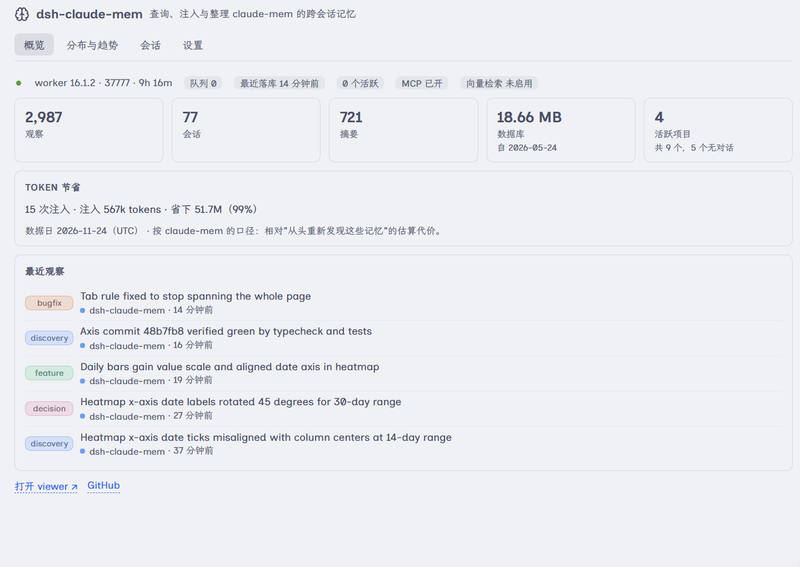
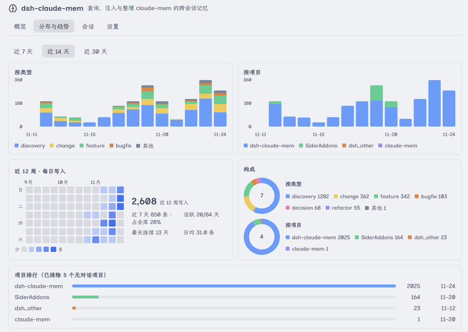
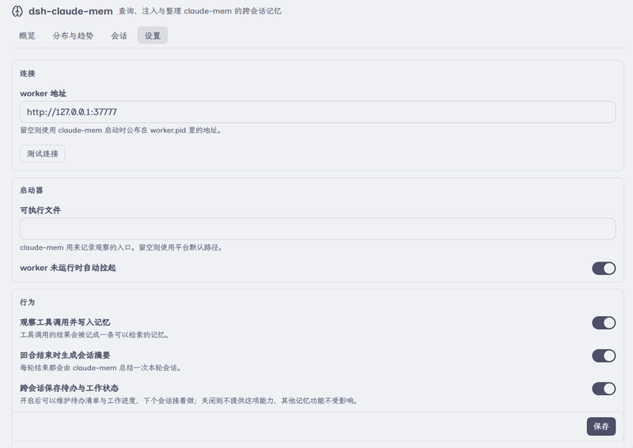

# dsh-claude-mem

<p align="center"></p>

为 [DeepSeek Harness](https://github.com/deepseek-ai) 接入全功能的 [claude-mem](https://github.com/thedotmack/claude-mem) 跨会话记忆能力：以会话启动时的上下文注入为基础，补齐官方 DSH adapter 未覆盖的记忆工具、文件上下文、子代理归档、失败观测与压缩后重注入。

[](LICENSE)
[](https://github.com/deepseek-ai)
[](https://nodejs.org/)
[](https://www.typescriptlang.org/)
[](https://github.com/thedotmack/claude-mem)

中文 · [English](README.en.md)

> Fork 自 [Bleed00/dsh-claude-mem](https://github.com/Bleed00/dsh-claude-mem)：在原有的 DSH 接入、记忆检索与手动保存的基础上扩展，接入更多 claude-mem 接口，包括 `mem_get_tool_uses`、`mem_dumb_search`、`mem_smart_search` / `mem_smart_outline` / `mem_smart_unfold`、`mem_corpus_*`、`work_state_*`，以及文件上下文、子代理归档、失败观测与压缩后重注入等。

## 前置条件

- DSH ≥ 0.2.1-rc.2
- [claude-mem](https://github.com/thedotmack/claude-mem) ≥ 15.17.0（已在 15.17.0 与 16.0.2 上验证），且 `claude-mem` 在 `PATH` 上。worker 由插件负责启动。

## 安装

按你实际在用的 profile 装（DSH 自带 `desktop` 与 `web` 两个）：

```sh
dsh plugin --profile desktop add @liuhuoz/dsh-claude-mem
# 网页端用：
dsh plugin --profile web add @liuhuoz/dsh-claude-mem
```

同一个包也可以直接从仓库安装，跟随 `main`：

```sh
dsh plugin --profile desktop add github:liuhuoz/dsh-claude-mem
```

想跟随后续开发的 `dev` 分支（未发布的改动会先合到这里）：

```sh
dsh plugin --profile desktop add github:liuhuoz/dsh-claude-mem#dev
```

`dev` 用于集成尚未发布的改动，可能随时变动；要稳定版本请用上面的 npm 安装或跟随 `main`。

`dsh` 不在 `PATH` 上时：

```sh
npx -y @deepseek-ai/dsh plugin --profile desktop add @liuhuoz/dsh-claude-mem
```

## 面板

入口默认关闭：打开设置里的「侧边栏入口」后，左侧栏会出现 dsh-claude-mem 图标和入口。

| 标签 | 内容 |
|---|---|
| 概览 | worker 状态、五个总量、token 节省与最近观察。 |
| 分布与趋势 | 每日堆叠柱、十二周热力图、构成环与项目排行，可按类型或项目筛选。 |
| 会话 | 最近一次上下文注入的摘要，以及产出过摘要的会话列表。 |
| 设置 | 下文的配置项。 |

<table>
  <tr>
    <td></td>
    <td></td>
    <td></td>
  </tr>
  <tr>
    <td align="center"><sub>概览</sub></td>
    <td align="center"><sub>分布与趋势</sub></td>
    <td align="center"><sub>设置</sub></td>
  </tr>
</table>

## 设置

全部在插件自己的页面里：**插件 → dsh-claude-mem → 配置**。

| 设置项 | 作用 |
|---|---|
| worker 地址 | 记忆服务的地址。留空则使用 claude-mem 启动时公布的地址；「测试连接」会用它探一次服务状态。 |
| 可执行文件 | 记录观察所用的 `claude-mem` 命令。留空则使用 `PATH` 上的 `claude-mem`。 |
| worker 未运行时自动拉起 | 没有 worker 在跑时，由插件启动一个。 |
| 观察工具调用并写入记忆 | 工具调用的结果会被记成一条可以检索的记忆。 |
| 回合结束时生成会话摘要 | 每轮结束都会由 claude-mem 总结一次本轮会话。 |
| 跨会话保存待办与工作状态 | 开启后可以维护待办清单与工作进度，下个会话接着做；关闭则不提供这项能力，其他记忆功能不受影响。 |
| 读取文件时带入相关记忆 | 读取文件时，附上记忆里关于这个文件的历史。 |
| 拒绝整篇读取已有记忆的大文件 | 记忆已覆盖的大文件不再允许整篇读取，改为分几次读。默认关闭；用户在 prompt 里点名该文件时放行。 |
| 把子代理的工作记在发起它的会话名下 | 子代理做的事也记在发起它的会话名下，结束时归档一条。 |
| 通过 claude-mem 结构化阅读代码 | 新增 `mem_smart_search` / `mem_smart_outline` / `mem_smart_unfold`：给文件大纲与单个符号的源码，而不是整篇文件。由模型按需调用；仅限当前工作目录。 |
| 知识语料库 | 新增六个 `mem_corpus_*` 工具：把记忆按主题切成语料库，可以针对某个主题提问。 |
| 侧边栏入口 | 把面板挂到左侧栏。关闭时仍可从 **插件 → dsh-claude-mem → 配置** 打开（见上文「面板」）。 |
| 观察白名单 | 仅在上方「观察工具调用并写入记忆」开启时生效；用逗号分隔，留空表示使用默认名单（高级）。 |
| 带入记忆的工具 | 仅在上方「读取文件时带入相关记忆」开启时生效；用逗号分隔，默认 `read`。`ops_bash` / `pwsh` 会从命令里解析文件，需要显式加入；`grep` / `glob` 暂不支持。 |

## 记忆只读

某个会话可以只读记忆：照常检索、照常注入项目上下文，但这次会话不写入任何记忆——不建会话行、不记工具观察、不写回合摘要、不归档子代理。适合一次性的临时会话。

开关在四个位置，任一处切换都会同步：输入框左侧、会话标题栏（同时是状态提醒）、新会话页工作区与运行模式两个下拉的右侧、输入框下方那一排小药丸。也可以直接用命令：

| 命令 | 作用 |
|---|---|
| `/mem-readonly` | 在只读与读写之间切换 |
| `/mem-readonly read-only` | 只读（等于 `on`） |
| `/mem-readonly read-write` | 恢复读写（等于 `off`） |

状态属于会话本身，记在它的日志里：重启、归档后再打开都保持不变；新建会话默认是读写。
